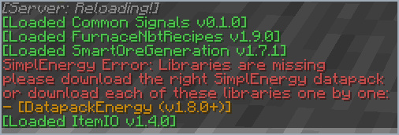
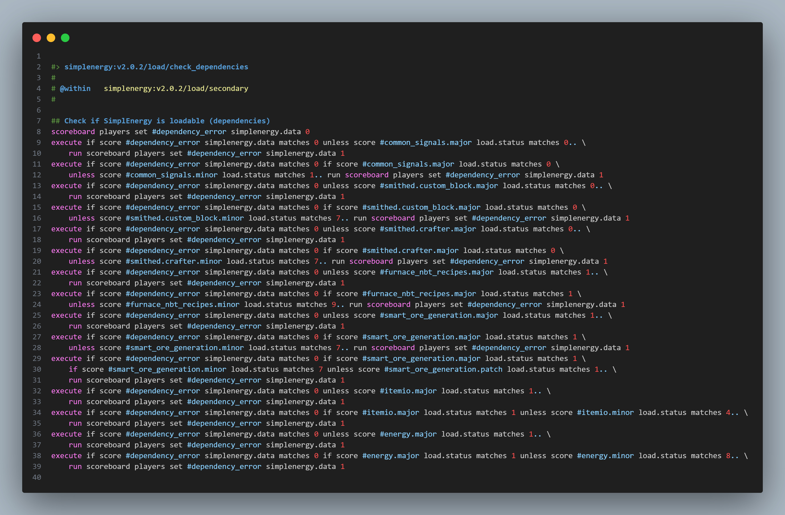

# Using datapack libraries

StewBeet handles libraries in two layers: official libraries it detects from your functions, with no configuration, and custom ones you declare as `load_dependencies` in `beet.yml`. Both are downloaded at build time and both get a runtime version check, with clickable error messages in chat.

- Config reference: [extensive/beet.yml](https://github.com/Stoupy51/StewBeet/blob/main/templates/extensive/beet.yml)
- Real-world example: [SimplEnergy/beet.yml](https://github.com/Stoupy51/SimplEnergy/blob/main/beet.yml)
- Source code: [stewbeet/plugins/finalyze/dependencies/\_\_init\_\_.py](https://github.com/Stoupy51/StewBeet/blob/main/python_package/stewbeet/plugins/finalyze/dependencies/__init__.py)

The `stewbeet.plugins.finalyze.dependencies` plugin goes after `mecha` in the pipeline, because it scans the finished functions to detect libraries, and after `stewbeet.plugins.datapack.loading`.

## Official libraries

The plugin scans every function of the pack and marks a library as used when its marker appears. Writing the library's namespace in a function is enough.

- Most libraries are detected by their namespace as a plain string, such as `itemio` or `common_signals`.
- Bookshelf modules are detected by a tag call, such as `#bs.math:`.
- Gamemode 4 libraries are detected by their namespace with a colon, such as `gm4_lore:`.
- A pack never detects itself, so a project named `itemio` does not pull `itemio` in.

Three libraries are pulled in by your declarations instead of by a string. `smithed.custom_block` comes with a block whose base item is `CUSTOM_BLOCK_VANILLA`, `smithed.crafter` with a crafting recipe that has a custom item as ingredient, and `smart_ore_generation` with a `CustomOreGeneration`.

### Supported libraries

| Key | Name | Source |
|-----|------|--------|
| `smithed.custom_block` | [Smithed Custom Block](https://wiki.smithed.dev/libraries/custom-block/) | Smithed |
| `smithed.crafter` | [Smithed Crafter](https://wiki.smithed.dev/libraries/crafter/) | Smithed |
| `smithed.actionbar` | [Smithed Actionbar](https://wiki.smithed.dev/libraries/actionbar/) | Smithed |
| `realistic_explosion` | [RealisticExplosion](https://github.com/Stoupy51/RealisticExplosion) | Smithed |
| `itemio` | [ItemIO](https://github.com/edayot/ItemIO) | Modrinth |
| `common_signals` | [Common Signals](https://github.com/Stoupy51/CommonSignals) | Modrinth |
| `furnace_nbt_recipes` | [Furnace NBT Recipes](https://github.com/Stoupy51/FurnaceNbtRecipes) | Modrinth |
| `smart_ore_generation` | [Smart Ore Generation](https://github.com/Stoupy51/SmartOreGeneration) | Modrinth |
| `cinemalya` | [Cinemalya](https://github.com/Stoupy51/Cinemalya) | Modrinth |
| `player_motion` | [Player Motion API](https://github.com/MulverineX/player_motion) | Modrinth |

`player_motion` is downloaded and merged, but it is left out of the Lantern Load enumeration and of the version checks.

Bookshelf has one key per module, all resolved through Modrinth: `bs.bitwise`, `bs.block`, `bs.color`, `bs.dump`, `bs.environment`, `bs.generation`, `bs.health`, `bs.hitbox`, `bs.id`, `bs.interaction`, `bs.link`, `bs.log`, `bs.math`, `bs.move`, `bs.position`, `bs.random`, `bs.raycast`, `bs.schedule`, `bs.sidebar`, `bs.spline`, `bs.string`, `bs.time`, `bs.tree`, `bs.vector`, `bs.view` and `bs.xp`. The [Bookshelf releases](https://github.com/mcbookshelf/bookshelf/releases) describe each one.

Six Gamemode 4 libraries come from Smithed, and their version check reads the GM4 scores (`gm4_forceload` and `gm4_forceload_minor` in `load.status`, for the first):

| Key | Library |
|-----|---------|
| `gm4_forceload` | lib_forceload |
| `gm4_hooked_entity` | lib_hooked_entity |
| `gm4_lore` | lib_lore |
| `gm4_machines` | lib_machines |
| `gm4_potion_tracking` | lib_potion_tracking |
| `gm4_trees` | lib_trees |

`lib_player_motion` is not supported: `player_motion` is the same library without the prefix.

`smart_ore_generation` also gets its function tags wired. If the pack has `calls/smart_ore_generation/generate_ores`, `denied_dimensions` or `post_generation` functions, they are added to the matching `smart_ore_generation:v1/signals/` tags.

### Generating custom ores with `CustomOreGeneration`

`CustomOreGeneration` writes those `generate_ores` functions for you, and using it pulls in `smart_ore_generation`. The library scans 96x96 regions around players and starts each vein at a random position next to air, so ores end up where players can find them.

```python
from stewbeet import CustomOreGeneration

CustomOreGeneration.all_with_config({
    "steel_ore": [
        # Common veins, from y=0 to y=50
        CustomOreGeneration(dimensions=["minecraft:overworld"], minimum_height=0, maximum_height=50, veins_per_region=1.2),
        # Extra veins in badlands only, replacing terracotta that has terracotta above it
        CustomOreGeneration(
            dimensions=["minecraft:overworld"],
            minimum_height=60,
            maximum_height=120,
            veins_per_region=2,
            provider=["#minecraft:terracotta"],
            vein_conditions=["if biome ~ ~ ~ #minecraft:is_badlands"],
            block_conditions=["if block ~ ~1 ~ #minecraft:terracotta"],
        ),
    ],
    "deepslate_steel_ore": [
        CustomOreGeneration(dimensions=["minecraft:overworld"], maximum_height=0, veins_per_region=1.2),
    ],
})
```

Call it from a plugin that runs after the custom blocks exist, like `src/link.py` in the [extensive template](https://github.com/Stoupy51/StewBeet/blob/main/templates/extensive/src/link.py). Keys are custom block ids (or `Block` objects), and an ore with several configurations gets one vein function per configuration.

| Field | Default | Meaning |
|-------|---------|---------|
| `dimensions` | required | Dimensions to generate in, ex: `["minecraft:overworld", "stardust:cavern"]` |
| `minimum_height` | `None` | Lowest y of a vein, `None` for the bottom of the overworld |
| `maximum_height` | `70` | Highest y of a vein |
| `veins_per_region` | `4` | Veins per region, the decimal part being a chance: `1.2` is one vein plus a 20% chance of a second |
| `vein_size_logic` | `0.4` | Vein size: `0.0` is a single block, `0.4` a small vein, `1.0` a large one |
| `provider` | the overworld carver replaceables | Block, block tag, or list of them, that the ore replaces. From 26.3 the default is the list of those blocks, since 26.3 has no such tag |
| `vein_conditions` | `[]` | Conditions checked once at the start of the vein, cancelling all of it |
| `block_conditions` | `[]` | Conditions checked at every block of the vein |
| `placer_command` | place the custom block | Execute subcommands ending with `run ...`, placing one ore at `~ ~ ~` |

Conditions are `execute` subcommands starting with `if ` or `unless `, and all of them must hold. Use `vein_conditions` for what is the same across a vein, like a biome (`if biome ~ ~ ~ #minecraft:is_badlands`), and `block_conditions` for what depends on each block, like its neighbours (`if block ~ ~-1 ~ minecraft:deepslate`). To only replace some blocks, set `provider` instead of adding a block condition.

When both `x_ore` and `deepslate_x_ore` are defined, the default placer keeps `x_ore` off deepslate and `deepslate_x_ore` off stone.

## Custom `load_dependencies`

Declare other libraries under `meta.stewbeet.load_dependencies` in `beet.yml`. The key is the library's namespace, and the runtime check reads its version from the score `#<key>.major load.status` (then `minor` and `patch`).

```yaml
meta:
  stewbeet:
    load_dependencies:
      # Smithed API: the latest version that supports the project's Minecraft version
      "smithed.crafter":
        name: "Smithed Crafter"
        url: "https://wiki.smithed.dev/libraries/crafter/"
        source: "smithed"
        smithed_id: "crafter"

      # Modrinth API: the latest release for the project's Minecraft version
      "itemio":
        name: "ItemIO"
        url: "https://github.com/edayot/ItemIO"
        source: "modrinth"
        modrinth_slug: "itemio"

      # No source: nothing is downloaded, the version is only checked at load
      "energy":
        version: [1, 8, 0]
        name: "DatapackEnergy"
        url: "https://github.com/ICY105/DatapackEnergy"
```

| Field | Needed | Description |
|-------|--------|-------------|
| `name` | Always | Display name in the in-game error |
| `url` | Always | Link the error message opens |
| `source` | No | `"smithed"` or `"modrinth"`. Without it, nothing is downloaded |
| `version` | Without `source` | `[major, minor, patch]` the loaded library must reach. With `"smithed"` it pins a version, and a build warns when that version does not exist |
| `smithed_id` | `"smithed"` | Pack id on the Smithed API |
| `modrinth_slug` | `"modrinth"` | Project slug on Modrinth |
| `no_lantern_load` | No | `true` leaves the library out of the Lantern Load enumeration and of the version checks |

With a `source`, the build writes the resolved `version` into the entry, so the check always matches the file that was downloaded. Smithed picks the latest version whose `supports` includes the project's Minecraft version, else the newest one made for an older version. Modrinth takes the newest release tagged for that version, else one made for an older version, and its second file is merged as the resource pack. Downloads are cached in `.beet_cache` for 30 days.

[SimplEnergy](https://github.com/Stoupy51/SimplEnergy) declares one Smithed dependency:

```yaml
meta:
  stewbeet:
    load_dependencies:
      energy:
        name: "DatapackEnergy"
        url: "https://github.com/ICY105/DatapackEnergy"
        source: "smithed"
        smithed_id: "energy"
```

## Runtime behaviour

A pack with at least one dependency, official or custom, loads in this order:

1. Lantern Load runs each dependency's `#<dep>:load` tag, and the libraries publish their versions to the `load.status` scoreboard.
2. `check_dependencies` sets `#dependency_error <ns>.data` to 1 when a version score is too old.
3. `valid_dependencies` waits for a player, reads their `DataVersion` and compares it with the oldest Minecraft version the pack supports (the lowest release of `mc_supports`). It then sends a `tellraw @a` with a clickable link for each failing library, and calls `confirm_load` only when every check passes.

A pack with no dependency has no check to run: its load function calls `confirm_load` directly, without waiting for a player.





## Generated files

| File | Type | Description |
|------|------|-------------|
| `minecraft:load` tag | Tag | Entry point: runs `#load:_private/load` |
| `load:load` tag | Tag | Points to `#<ns>:load` |
| `<ns>:load` tag | Tag | Runs `#<ns>:enumerate` then `#<ns>:resolve` |
| `<ns>:enumerate` tag | Tag | Starts with `#<ns>:dependencies`, written when there is a dependency |
| `<ns>:dependencies` tag | Tag | Lists `#<dep>:load` for every dependency, and `#bs.load:load` for Bookshelf modules |
| `load:_private/init` | Function | Resets the `load.status` scoreboard |
| `<ns>:v<version>/load/secondary` | Function | Registers the `<ns>.data` scoreboard, then runs the checks or confirms the load |
| `<ns>:v<version>/load/check_dependencies` | Function | Sets `#dependency_error` from the version scores |
| `<ns>:v<version>/load/valid_dependencies` | Function | Waits for a player, checks `DataVersion`, shows the errors |
| `<ns>:v<version>/load/confirm_load` | Function | Runs only when every check passes |
| `<ns>:v<version>/load/tick_verification` | Function | Runs the pack's tick function only when its own version scores match, written when the pack has a tick function |

## Glossary

| Term | Meaning |
|------|---------|
| `load_dependencies` | A `meta.stewbeet` dict in `beet.yml` where you declare libraries to download and version-check at runtime. |
| Source | How a library is resolved: `"smithed"` (Smithed API) or `"modrinth"` (Modrinth API). |
| Official library | A library registered in StewBeet's `OFFICIAL_LIBS`, detected from your functions with no configuration. |
| Lantern Load | A community standard for datapack loading order, which StewBeet sets up for you. |
| `DataVersion` | An entity NBT field that gives the running Minecraft version, compared with the oldest version in `mc_supports`. |

## Next steps

- [Configuring the build](../3_beet_config/en.md#load_dependencies): where `load_dependencies` goes in `beet.yml`.
- [finalyze.dependencies](../plugins/finalyze.dependencies.md): the plugin that writes the checks.
- [Publishing releases](../6_continuous_delivery/en.md): ship a pack that depends on these libraries.

