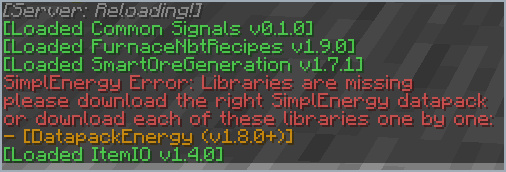
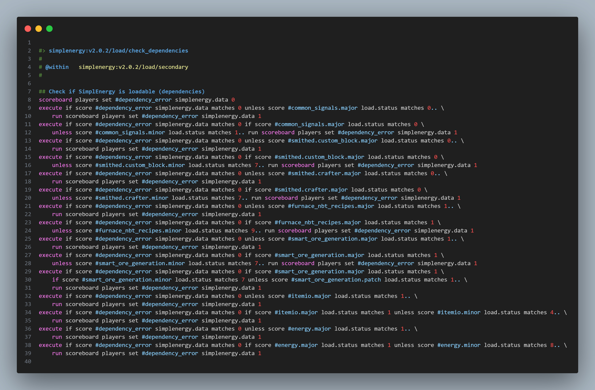

# Utiliser des bibliothèques de datapack

StewBeet gère les bibliothèques en deux couches : les bibliothèques officielles qu'il détecte depuis vos functions, sans configuration, et les bibliothèques custom que vous déclarez en `load_dependencies` dans `beet.yml`. Les deux sont téléchargées au build et les deux ont une vérification de version à l'exécution, avec des messages d'erreur cliquables dans le chat.

- Référence de config : [extensive/beet.yml](https://github.com/Stoupy51/StewBeet/blob/main/templates/extensive/beet.yml)
- Exemple réel : [SimplEnergy/beet.yml](https://github.com/Stoupy51/SimplEnergy/blob/main/beet.yml)
- Code source : [stewbeet/plugins/finalyze/dependencies/\_\_init\_\_.py](https://github.com/Stoupy51/StewBeet/blob/main/python_package/stewbeet/plugins/finalyze/dependencies/__init__.py)

Le plugin `stewbeet.plugins.finalyze.dependencies` passe après `mecha` dans le pipeline, parce qu'il scanne les functions terminées pour détecter les bibliothèques, et après `stewbeet.plugins.datapack.loading`.

## Bibliothèques officielles

Le plugin scanne chaque function du pack et marque une bibliothèque comme utilisée quand son marqueur apparaît. Écrire le namespace de la bibliothèque dans une function suffit.

- La plupart des bibliothèques sont détectées par leur namespace en simple chaîne, comme `itemio` ou `common_signals`.
- Les modules Bookshelf sont détectés par un appel de tag, comme `#bs.math:`.
- Les bibliothèques Gamemode 4 sont détectées par leur namespace suivi de deux-points, comme `gm4_lore:`.
- Un pack ne se détecte jamais lui-même, donc un projet nommé `itemio` n'embarque pas `itemio`.

Trois bibliothèques sont embarquées par vos déclarations plutôt que par une chaîne. `smithed.custom_block` vient avec un block dont l'item de base est `CUSTOM_BLOCK_VANILLA`, `smithed.crafter` avec une recipe de crafting qui a un item custom en ingrédient, et `smart_ore_generation` avec un `CustomOreGeneration`.

### Bibliothèques supportées

| Clé | Nom | Source |
|-----|-----|--------|
| `smithed.custom_block` | [Smithed Custom Block](https://wiki.smithed.dev/libraries/custom-block/) | Smithed |
| `smithed.crafter` | [Smithed Crafter](https://wiki.smithed.dev/libraries/crafter/) | Smithed |
| `smithed.actionbar` | [Smithed Actionbar](https://wiki.smithed.dev/libraries/actionbar/) | Smithed |
| `realistic_explosion` | [RealisticExplosion](https://github.com/Stoupy51/RealisticExplosion) | Smithed |
| `itemio` | [ItemIO](https://github.com/edayot/ItemIO) | Modrinth |
| `common_signals` | [Common Signals](https://github.com/Stoupy51/CommonSignals) | Modrinth |
| `furnace_nbt_recipes` | [Furnace NBT Recipes](https://github.com/Stoupy51/FurnaceNbtRecipes) | Modrinth |
| `smart_ore_generation` | [Smart Ore Generation](https://github.com/Stoupy51/SmartOreGeneration) | Modrinth |
| `cinemalya` | [Cinemalya](https://github.com/Stoupy51/Cinemalya) | Modrinth |
| `player_motion` | [Player Motion API](https://github.com/MulverineX/player_motion) | Modrinth |

`player_motion` est téléchargée et fusionnée, mais elle est laissée hors de l'énumération Lantern Load (la convention de la communauté qui fixe l'ordre de chargement des datapacks) et des vérifications de version.

Bookshelf a une clé par module, toutes résolues via Modrinth : `bs.bitwise`, `bs.block`, `bs.color`, `bs.dump`, `bs.environment`, `bs.generation`, `bs.health`, `bs.hitbox`, `bs.id`, `bs.interaction`, `bs.link`, `bs.log`, `bs.math`, `bs.move`, `bs.position`, `bs.random`, `bs.raycast`, `bs.schedule`, `bs.sidebar`, `bs.spline`, `bs.string`, `bs.time`, `bs.tree`, `bs.vector`, `bs.view` et `bs.xp`. Les [releases de Bookshelf](https://github.com/mcbookshelf/bookshelf/releases) décrivent chacun d'eux.

Six bibliothèques Gamemode 4 viennent de Smithed, et leur vérification de version lit les scores GM4 (`gm4_forceload` et `gm4_forceload_minor` dans `load.status`, pour la première) :

| Clé | Bibliothèque |
|-----|-----------|
| `gm4_forceload` | lib_forceload |
| `gm4_hooked_entity` | lib_hooked_entity |
| `gm4_lore` | lib_lore |
| `gm4_machines` | lib_machines |
| `gm4_potion_tracking` | lib_potion_tracking |
| `gm4_trees` | lib_trees |

`lib_player_motion` n'est pas supportée : `player_motion` est la même bibliothèque sans le préfixe.

`smart_ore_generation` a aussi ses function tags branchés. Si le pack a des functions `calls/smart_ore_generation/generate_ores`, `denied_dimensions` ou `post_generation`, elles sont ajoutées aux tags `smart_ore_generation:v1/signals/` correspondants.

### Générer des ores custom avec `CustomOreGeneration`

`CustomOreGeneration` écrit pour vous ces functions `generate_ores`, et l'utiliser embarque `smart_ore_generation`. La bibliothèque scanne des régions de 96x96 autour des joueurs et démarre chaque veine à une position aléatoire à côté de l'air, donc les ores se retrouvent là où les joueurs peuvent les trouver.

```python
from stewbeet import CustomOreGeneration

CustomOreGeneration.all_with_config({
    "steel_ore": [
        # Common veins, from y=0 to y=50
        CustomOreGeneration(dimensions=["minecraft:overworld"], minimum_height=0, maximum_height=50, veins_per_region=1.2),
        # Extra veins in badlands only, replacing terracotta that has terracotta above it
        CustomOreGeneration(
            dimensions=["minecraft:overworld"],
            minimum_height=60,
            maximum_height=120,
            veins_per_region=2,
            provider=["#minecraft:terracotta"],
            vein_conditions=["if biome ~ ~ ~ #minecraft:is_badlands"],
            block_conditions=["if block ~ ~1 ~ #minecraft:terracotta"],
        ),
    ],
    "deepslate_steel_ore": [
        CustomOreGeneration(dimensions=["minecraft:overworld"], maximum_height=0, veins_per_region=1.2),
    ],
})
```

Appelez-le depuis un plugin qui s'exécute après l'existence des custom blocks, comme `src/link.py` dans le [template extensive](https://github.com/Stoupy51/StewBeet/blob/main/templates/extensive/src/link.py). Les clés sont des ids de custom blocks (ou des objets `Block`), et un ore avec plusieurs configurations reçoit une function de veine par configuration.

| Champ | Défaut | Sens |
|-------|--------|------|
| `dimensions` | requis | Dimensions où générer, ex : `["minecraft:overworld", "stardust:cavern"]` |
| `minimum_height` | `None` | Plus bas y d'une veine, `None` pour le fond de l'overworld |
| `maximum_height` | `70` | Plus haut y d'une veine |
| `veins_per_region` | `4` | Veines par région, la partie décimale étant une chance : `1.2` est une veine plus 20 % de chance d'une seconde |
| `vein_size_logic` | `0.4` | Taille de la veine : `0.0` est un seul block, `0.4` une petite veine, `1.0` une grande |
| `provider` | les replaceables du carver de l'overworld | Block, block tag, ou liste de ceux-ci, que l'ore remplace. À partir de 26.3 le défaut est la liste de ces blocks, puisque 26.3 n'a pas un tel tag |
| `vein_conditions` | `[]` | Conditions vérifiées une fois au début de la veine, qui l'annulent entièrement |
| `block_conditions` | `[]` | Conditions vérifiées à chaque block de la veine |
| `placer_command` | placer le custom block | Sous-commandes execute qui finissent par `run ...`, et placent un ore à `~ ~ ~` |

Les conditions sont des sous-commandes `execute` qui commencent par `if ` ou `unless `, et toutes doivent être vraies. Utilisez `vein_conditions` pour ce qui est identique sur toute une veine, comme un biome (`if biome ~ ~ ~ #minecraft:is_badlands`), et `block_conditions` pour ce qui dépend de chaque block, comme ses voisins (`if block ~ ~-1 ~ minecraft:deepslate`). Pour ne remplacer que certains blocks, définissez `provider` au lieu d'ajouter une condition de block.

Quand `x_ore` et `deepslate_x_ore` sont tous deux définis, le placer par défaut garde `x_ore` hors de la deepslate et `deepslate_x_ore` hors de la pierre.

## `load_dependencies` personnalisés

Déclarez d'autres bibliothèques sous `meta.stewbeet.load_dependencies` dans `beet.yml`. La clé est le namespace de la bibliothèque, et la vérification à l'exécution lit sa version dans le score `#<key>.major load.status` (puis `minor` et `patch`).

```yaml
meta:
  stewbeet:
    load_dependencies:
      # Smithed API: the latest version that supports the project's Minecraft version
      "smithed.crafter":
        name: "Smithed Crafter"
        url: "https://wiki.smithed.dev/libraries/crafter/"
        source: "smithed"
        smithed_id: "crafter"

      # Modrinth API: the latest release for the project's Minecraft version
      "itemio":
        name: "ItemIO"
        url: "https://github.com/edayot/ItemIO"
        source: "modrinth"
        modrinth_slug: "itemio"

      # No source: nothing is downloaded, the version is only checked at load
      "energy":
        version: [1, 8, 0]
        name: "DatapackEnergy"
        url: "https://github.com/ICY105/DatapackEnergy"
```

| Champ | Requis | Description |
|-------|--------|-------------|
| `name` | Toujours | Nom affiché dans l'erreur en jeu |
| `url` | Toujours | Lien que le message d'erreur ouvre |
| `source` | Non | `"smithed"` ou `"modrinth"`. Sans lui, rien n'est téléchargé |
| `version` | Sans `source` | `[major, minor, patch]` que la bibliothèque chargée doit atteindre. Avec `"smithed"` il fixe une version, et un build avertit quand cette version n'existe pas |
| `smithed_id` | `"smithed"` | Id du pack sur l'API Smithed |
| `modrinth_slug` | `"modrinth"` | Slug du projet sur Modrinth |
| `no_lantern_load` | Non | `true` laisse la bibliothèque hors de l'énumération Lantern Load et des vérifications de version |

Avec une `source`, le build écrit la `version` résolue dans l'entrée, donc la vérification correspond toujours au fichier téléchargé. Smithed choisit la dernière version dont `supports` inclut la version de Minecraft du projet, sinon la plus récente faite pour une version plus ancienne. Modrinth prend la release la plus récente taguée pour cette version, sinon une faite pour une version plus ancienne, et son deuxième fichier est fusionné comme resource pack. Les téléchargements sont mis en cache dans `.beet_cache` pendant 30 jours.

[SimplEnergy](https://github.com/Stoupy51/SimplEnergy) déclare une dépendance Smithed :

```yaml
meta:
  stewbeet:
    load_dependencies:
      energy:
        name: "DatapackEnergy"
        url: "https://github.com/ICY105/DatapackEnergy"
        source: "smithed"
        smithed_id: "energy"
```

## Comportement à l'exécution

Un pack avec au moins une dépendance, officielle ou custom, se charge dans cet ordre :

1. Lantern Load exécute le tag `#<dep>:load` de chaque dépendance, et les bibliothèques publient leurs versions dans le scoreboard `load.status`.
2. `check_dependencies` met `#dependency_error <ns>.data` à 1 quand un score de version est trop ancien.
3. `valid_dependencies` attend un joueur, lit son `DataVersion` (le champ NBT du joueur qui contient la version de Minecraft en cours) et le compare à la plus ancienne version de Minecraft que le pack supporte (la plus basse release de `mc_supports`). Il envoie ensuite un `tellraw @a` avec un lien cliquable pour chaque bibliothèque en échec, et n'appelle `confirm_load` que si toutes les vérifications passent.

Un pack sans dépendance n'a aucune vérification à faire : sa function load appelle `confirm_load` directement, sans attendre de joueur.





## Fichiers générés

| Fichier | Type | Description |
|---------|------|-------------|
| tag `minecraft:load` | Tag | Point d'entrée : exécute `#load:_private/load` |
| tag `load:load` | Tag | Pointe vers `#<ns>:load` |
| tag `<ns>:load` | Tag | Exécute `#<ns>:enumerate` puis `#<ns>:resolve` |
| tag `<ns>:enumerate` | Tag | Commence par `#<ns>:dependencies`, écrit quand il y a une dépendance |
| tag `<ns>:dependencies` | Tag | Liste `#<dep>:load` pour chaque dépendance, et `#bs.load:load` pour les modules Bookshelf |
| `load:_private/init` | Function | Réinitialise le scoreboard `load.status` |
| `<ns>:v<version>/load/secondary` | Function | Enregistre le scoreboard `<ns>.data`, puis lance les vérifications ou confirme le chargement |
| `<ns>:v<version>/load/check_dependencies` | Function | Met `#dependency_error` depuis les scores de version |
| `<ns>:v<version>/load/valid_dependencies` | Function | Attend un joueur, vérifie `DataVersion`, affiche les erreurs |
| `<ns>:v<version>/load/confirm_load` | Function | S'exécute seulement quand toutes les vérifications passent |
| `<ns>:v<version>/load/tick_verification` | Function | Lance la function tick du pack seulement quand ses propres scores de version correspondent, écrite quand le pack a une function tick |

## Pour continuer

- [Configurer le build](../3_beet_config/fr.md#load_dependencies) : où va `load_dependencies` dans `beet.yml`.
- [finalyze.dependencies](../plugins/finalyze.dependencies.fr.md) : le plugin qui écrit les vérifications.
- [Publier des releases](../6_continuous_delivery/fr.md) : livrez un pack qui dépend de ces bibliothèques.

