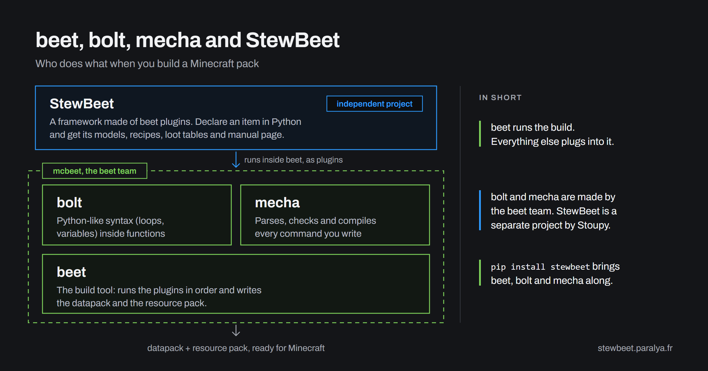

# How StewBeet fits with beet

StewBeet is a set of plugins for beet, the build tool of the mcbeet team. beet runs the build, mecha and bolt read your commands, and StewBeet writes the files your definitions need.

## beet runs the build

beet reads `beet.yml`, loads the datapack and the resource pack of your project in memory, and hands them to each plugin of the file in turn: first the ones under `require`, then the `pipeline`. A plugin is a Python function that adds, changes or removes files in those packs. Once the last one has run, beet writes both packs to the output folder.

`stewbeet build` runs beet on your project, and `stewbeet watch` runs it again on every save. Every beet plugin works in a StewBeet project, and every option beet reads keeps its meaning.

## mecha and bolt read your commands

mecha parses every function of the datapack, checks each command against the Minecraft version you target, and fails the build on a typo the game would only report at `/reload`. bolt, built on mecha, lets a function hold Python: loops, variables and imports, compiled down to plain commands.

Both are made by the beet team and installed with StewBeet.

## StewBeet is the rest of the pipeline

The `stewbeet` entry of `require` loads your definitions. Each step of the template's `pipeline` is one StewBeet plugin with its own page under [Plugins](../plugins/README.md): models, recipes, loot tables, the manual, the zips. A plugin you do not need comes out of the list, and a beet plugin of your own goes anywhere in it.

Your Python calls, such as `write_function`, write into the same packs beet holds, so the plugins after them see your files too.

## What else it relies on

- The datapack libraries your functions call, such as Smithed Custom Block or a Bookshelf module, downloaded and checked in game. [Datapack libraries](../5_dependencies/en.md) lists them.
- model_resolver renders each item to an image for the [in-game manual](../7_ingame_manual/en.md).
- Spyglass, through the [VS Code extension](../8_editor/en.md), checks the commands inside your Python strings as you type.

The [credits](/credits) thank the people behind each one.

## Next steps

- [beet.yml](../3_beet_config/en.md): every option of the file, `require` and `pipeline` included.
- [Plugins](../plugins/README.md): what each step of the pipeline writes.

