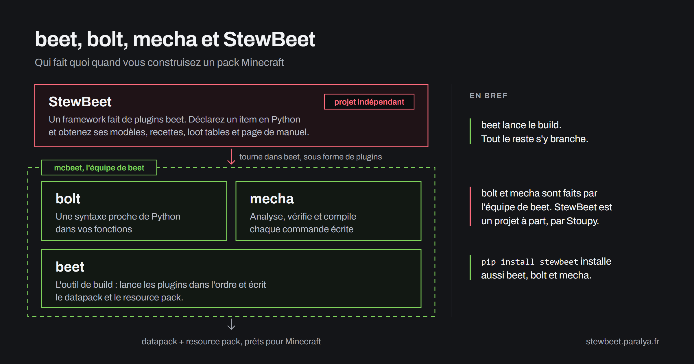

# Comment StewBeet s'intègre à beet

StewBeet est un ensemble de plugins pour beet, l'outil de build de l'équipe mcbeet. beet lance le build, mecha et bolt lisent vos commandes, et StewBeet écrit les fichiers dont vos définitions ont besoin.

## beet lance le build

beet lit `beet.yml`, charge en mémoire le datapack et le resource pack de votre projet, et les passe tour à tour à chaque plugin du fichier : d'abord ceux de `require`, puis le `pipeline`. Un plugin est une fonction Python qui ajoute, modifie ou retire des fichiers de ces packs. Une fois le dernier passé, beet écrit les deux packs dans le dossier de sortie.

`stewbeet build` lance beet sur votre projet, et `stewbeet watch` le relance à chaque sauvegarde. Tout plugin beet fonctionne dans un projet StewBeet, et chaque option que lit beet garde son sens.

## mecha et bolt lisent vos commandes

mecha analyse chaque fonction du datapack, vérifie chaque commande pour la version de Minecraft visée, et fait échouer le build sur une faute de frappe que le jeu ne signalerait qu'au `/reload`. bolt, construit sur mecha, permet d'écrire du Python dans une fonction : boucles, variables et imports, compilés en commandes ordinaires.

Les deux sont faits par l'équipe de beet et installés avec StewBeet.

## StewBeet est le reste du pipeline

L'entrée `stewbeet` de `require` charge vos définitions. Chaque étape du `pipeline` d'un template est un plugin StewBeet qui a sa page dans [Plugins](../plugins/README.md) : modèles, recipes, loot tables, manuel, zips. Un plugin inutile sort de la liste, et un plugin beet à vous se place où vous voulez.

Vos appels Python, comme `write_function`, écrivent dans les mêmes packs que ceux que beet tient en mémoire, donc les plugins suivants voient aussi vos fichiers.

## Sur quoi d'autre il s'appuie

- Les bibliothèques de datapacks qu'appellent vos fonctions, comme Smithed Custom Block ou un module de Bookshelf, téléchargées puis vérifiées en jeu. [Bibliothèques de datapacks](../5_dependencies/fr.md) les liste.
- model_resolver dessine chaque item en image pour le [manuel en jeu](../7_ingame_manual/fr.md).
- Spyglass, via l'[extension VS Code](../8_editor/fr.md), vérifie pendant la frappe les commandes écrites dans vos chaînes Python.

Les [crédits](/credits) remercient les personnes derrière chacun d'eux.

## Étapes suivantes

- [beet.yml](../3_beet_config/fr.md) : chaque option du fichier, `require` et `pipeline` compris.
- [Plugins](../plugins/README.md) : ce qu'écrit chaque étape du pipeline.

