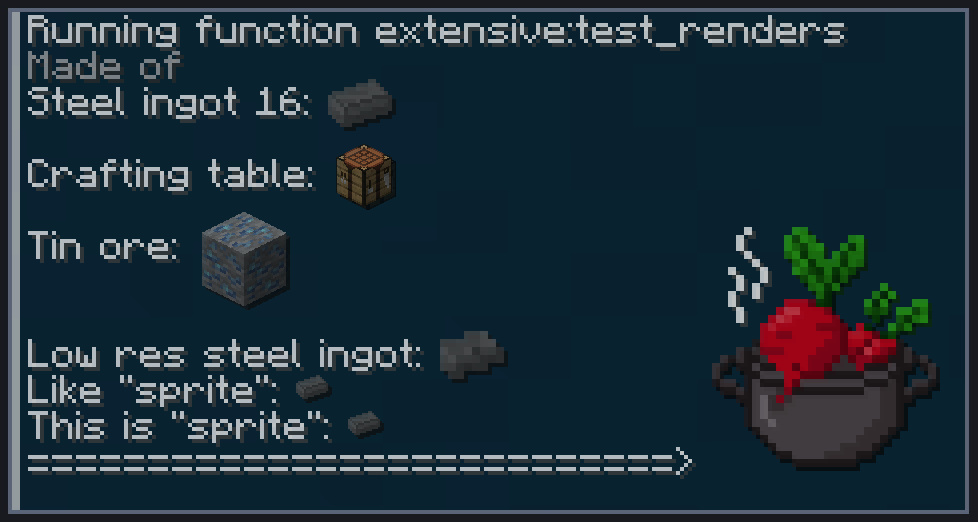

# Item images in text

Permet à un text component d'afficher l'image d'un item : lore, `tellraw`, dialogs du manuel, partout où va du texte.

Il tourne dans les templates `basic` et `extensive` sous le nom `stewbeet.plugins.auto.text_renders`, après [Lang file](auto.lang_file.fr.md). Il lit `iso_renders_path` et le bloc optionnel `text_renders` de `meta.stewbeet`. [Source](https://github.com/Stoupy51/StewBeet/blob/main/python_package/stewbeet/plugins/auto/text_renders/__init__.py)

## Écrire un render node

Mettez une clé `render` là où irait un `text` :

```json
[
  {"render": "steel_ingot"},
  {"render": "minecraft:stone"},
  {"render": "ICON", "height": 32}
]
```

- `steel_ingot` est un item de votre projet, `minecraft:stone` un item vanilla, `mechanization:tin_ore` un item d'un autre pack.
- `ICON` est votre `pack.png`.
- Une valeur finissant par `.png` est une image de votre projet : `beer.png` est lue dans `textures_folder`, et un chemin qui existe tel quel marche aussi.
- `height` est la hauteur affichée en pixels (`default_height` si omise).
- `resolution` réduit la texture stockée à cette hauteur sans changer l'affichage. Par défaut, l'image est stockée telle quelle.
- `ascent` déplace la ligne de base. Par défaut, l'image est centrée sur la ligne de texte.
- `offset` déplace le stylo de ce nombre de pixels avant l'image. Il peut être négatif.
- `offset_after` est le nombre de pixels entre le bord droit de l'image et le stylo une fois l'image dessinée. Il peut être négatif. Sans lui, l'avance de Minecraft s'applique.

Toutes les autres clés du node (`color`, `hover_event`, `click_event`) restent sur le glyphe.



## Espace négatif : des images côte à côte

Le texte est dessiné par un stylo qui avance vers la droite. Un glyphe le déplace de la largeur visible de l'image plus un pixel, et un `offset` ou un `offset_after` négatif le fait reculer. C'est ainsi que des images se superposent, se placent à côté du texte sans le pousser, ou composent une mise en page dans une seule ligne.

```json
[
  {"render": "steel_ingot", "height": 16},
  {"render": "raw_steel", "height": 16, "offset": -12, "offset_after": 4},
  "end"
]
```

La seconde image commence 12 pixels en arrière, sur la première, et `end` la suit 4 pixels après son bord droit. `offset_after` compte depuis le bord de l'image, donc les colonnes transparentes d'une image ne le changent pas.

Pour dessiner une image sans déplacer la ligne, renvoyez le stylo en arrière de la largeur de l'image plus un écart, puis en avant de cet écart : `offset` vaut `-(largeur + écart)` et `offset_after` vaut `écart`. La ligne garde sa longueur, donc un dialog qui la centre la laisse où elle était. `ascent` règle alors la hauteur de l'image par rapport à la ligne.

[DynamicBookBreakdown](https://github.com/Stoupy51/DynamicBookBreakdown) montre la même technique avec des espaces de font bruts, sur un livre entier.

## D'où viennent les images

Le PNG de chaque item est `<iso_renders_path>/<namespace>/<item>.png` :

- Un item du projet est rendu à partir de son model.
- Un item `minecraft:` est téléchargé depuis le wiki.
- Un item d'un autre pack est un PNG que vous placez vous-même ici, ou au même chemin sous `textures_folder`.

`stewbeet clean` supprime `iso_renders_path` et garde `textures_folder` : les images faites à la main vont donc dans ce dernier.

## Ce que ce plugin écrit

- `font/renders.json` dans votre namespace : un glyphe par item distinct, avec hauteur, ascent et resolution.
- `textures/font/renders/<namespace>_<item>_<W>x<H>.png` : une texture par item et par taille stockée.
- Chaque render node réécrit en `{"text": "<glyph>", "font": "<namespace>:renders"}`.

## Options

Dans `meta.stewbeet` :

| Option | Défaut | Ce qu'elle fait |
|---|---|---|
| `iso_renders_path` | `manual_cache/items` | Dossier des PNG d'items, partagé avec le manuel |
| `text_renders.default_height` | `16` | Hauteur affichée quand un node n'a pas de `height` |
| `text_renders.default_resolution` | `0` | Hauteur stockée quand un node n'a pas de `resolution`, 0 garde la source |
| `text_renders.font` | `renders` | Nom de la font, dans votre namespace |
| `text_renders.cache_assets` | `manual.cache_assets`, sinon `true` | Réutilise les PNG qui existent déjà |
| `text_renders.allow_oversized` | demandé dans le terminal | `true` découpe une image de plus de 256x256 en plusieurs glyphes, `false` la réduit en un seul |

## Limites

- Un id sans PNG reçoit un avertissement et le node reste tel qu'écrit.
- Un node qui a à la fois `render` et `text` avertit, et le `text` est abandonné.
- Une image de plus de 256x256 coûte une texture par tuile. Sans `allow_oversized`, le premier build pose la question. Sans terminal pour répondre, il découpe et pose la question de nouveau au build suivant.
- Minecraft refuse un glyphe dont l'`ascent` dépasse la `height`. Une image dessinée entièrement au-dessus de la ligne de base est stockée à 256 pixels au plus, et le build avertit avec l'`ascent` qui garde la taille complète.
- Une image large est du texte ordinaire : le chat la fait passer à la ligne.
- Une texture vanilla animée montre sa première frame.

## Pour continuer

- [Manuel en jeu](../7_ingame_manual/fr.md) : partage les PNG d'items et utilise ces glyphes dans les titres de ses dialogs.
- [DynamicBookBreakdown](https://github.com/Stoupy51/DynamicBookBreakdown) : un cours sur les fonts, l'`ascent`, la `height` et l'avance d'un glyphe, qui explique le découpage et l'espacement utilisés ici.

