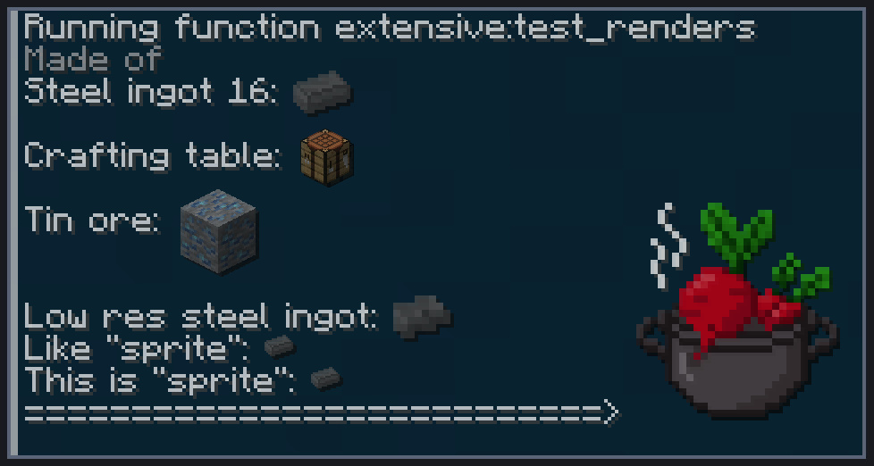

# Item images in text

Lets a text component show the picture of an item: lore, `tellraw`, manual dialogs, anywhere text goes.

It runs in the `basic` and `extensive` templates as `stewbeet.plugins.auto.text_renders`, after [Lang file](auto.lang_file.md). It reads `iso_renders_path` and the optional `text_renders` block of `meta.stewbeet`. [Source](https://github.com/Stoupy51/StewBeet/blob/main/python_package/stewbeet/plugins/auto/text_renders/__init__.py)

## Write a render node

Put a `render` key where a `text` would go:

```json
[
  {"render": "steel_ingot"},
  {"render": "minecraft:stone"},
  {"render": "ICON", "height": 32}
]
```

- `steel_ingot` is an item of your project, `minecraft:stone` a vanilla item, `mechanization:tin_ore` an item of another pack.
- `ICON` is your `pack.png`.
- A value ending with `.png` is a picture of your project: `beer.png` is read from `textures_folder`, and a path that exists as written works too.
- `height` is the displayed height in pixels (`default_height` when omitted).
- `resolution` shrinks the stored texture to that height without changing the display. By default the image is stored untouched.
- `ascent` moves the baseline. By default the picture is centred on the line of text.
- `offset` moves the pen by that many pixels before the picture. It can be negative.
- `offset_after` is the number of pixels between the right edge of the picture and the pen once it is drawn. It can be negative. When omitted, Minecraft's own advance applies.

Every other key of the node (`color`, `hover_event`, `click_event`) is kept on the glyph.



## Negative space: pictures side by side

Text is drawn by a pen that moves right. A glyph moves it by the visible width of the picture plus one pixel, and a negative `offset` or `offset_after` moves it back. That is how pictures overlap, sit beside text without pushing it, or build a layout out of one line.

```json
[
  {"render": "steel_ingot", "height": 16},
  {"render": "raw_steel", "height": 16, "offset": -12, "offset_after": 4},
  "end"
]
```

The second picture starts 12 pixels back, over the first one, and `end` follows it 4 pixels after its right edge. `offset_after` counts from the edge of the picture, so the transparent columns of an image do not change it.

To draw a picture without moving the line, send the pen back by the picture's width plus a gap, then forward by the gap: `offset` is `-(width + gap)` and `offset_after` is `gap`. The line keeps its length, so a dialog that centres it keeps it where it was. `ascent` then sets how high the picture sits against the line.

[DynamicBookBreakdown](https://github.com/Stoupy51/DynamicBookBreakdown) shows the same technique with raw font spaces, over a whole book.

## Where the pictures come from

The PNG for each item is `<iso_renders_path>/<namespace>/<item>.png`:

- A project item is rendered from its model.
- A `minecraft:` item is downloaded from the wiki.
- An item of another pack is a PNG you put there yourself, or in the same path under `textures_folder`.

`stewbeet clean` deletes `iso_renders_path` and keeps `textures_folder`, so hand-made pictures belong in the latter.

## What this plugin writes

- `font/renders.json` in your namespace: one glyph per distinct item, height, ascent and resolution.
- `textures/font/renders/<namespace>_<item>_<W>x<H>.png`: one texture per item and stored size.
- Each `render` node rewritten as `{"text": "<glyph>", "font": "<namespace>:renders"}`.

## Options

In `meta.stewbeet`:

| Option | Default | What it does |
|---|---|---|
| `iso_renders_path` | `manual_cache/items` | Folder of the item PNGs, shared with the manual |
| `text_renders.default_height` | `16` | Displayed height when a node has no `height` |
| `text_renders.default_resolution` | `0` | Stored height when a node has no `resolution`, 0 keeps the source |
| `text_renders.font` | `renders` | Name of the font, in your namespace |
| `text_renders.cache_assets` | `manual.cache_assets`, else `true` | Reuse PNGs that already exist |
| `text_renders.allow_oversized` | asked in the terminal | `true` cuts a picture over 256x256 into several glyphs, `false` shrinks it to one |

## Limits

- An id with no PNG gets a warning and the node stays as written.
- A node with both `render` and `text` warns, and the `text` is dropped.
- A picture over 256x256 costs one texture per tile. Without `allow_oversized`, the first build asks. With no terminal to answer, it cuts and asks again next build.
- Minecraft refuses a glyph whose `ascent` is higher than its `height`. A picture drawn entirely above the baseline is stored at 256 pixels at most, and the build warns with the `ascent` that keeps the full size.
- A wide picture is plain text: chat wraps it.
- An animated vanilla texture shows its first frame.

## Next steps

- [In-game manual](../7_ingame_manual/en.md): shares the item PNGs and uses these glyphs in its dialog titles.
- [DynamicBookBreakdown](https://github.com/Stoupy51/DynamicBookBreakdown): a course on fonts, `ascent`, `height` and the glyph advance, which explains the cutting and spacing used here.

