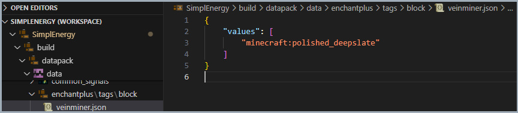

# NeoEnchant

Fait miner vos minerais custom par l'enchantement Veinminer de NeoEnchant.

Il tourne dans les templates `basic` et `extensive` sous le nom `stewbeet.plugins.compatibilities.neo_enchant`, sans configuration. [Source](https://github.com/Stoupy51/StewBeet/blob/main/python_package/stewbeet/plugins/compatibilities/neo_enchant/__init__.py)

Les helpers de minerai des définitions posent les minerais custom sur `minecraft:polished_deepslate`. Veinminer ne casse que les blocks de son tag, donc ce plugin y ajoute ce block.

## Ce que ce plugin écrit

- Le tag de block `enchantplus:veinminer`, qui contient `minecraft:polished_deepslate`.

Il n'est écrit que si l'un de vos blocks a `polished_deepslate` pour `vanilla_block`.

## Limites

- Tout block de polished deepslate du monde devient minable en veine, vos minerais ou non.
- Le tag ne liste que le polished deepslate. Il remplace tout tag `enchantplus:veinminer` venant de vos propres fichiers source.
- Sans block correspondant, rien n'est écrit et le build n'avertit pas.

