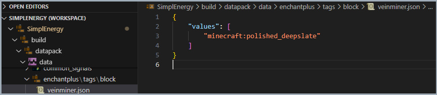

# NeoEnchant

Makes NeoEnchant's Veinminer enchantment mine your custom ores.

It runs in the `basic` and `extensive` templates as `stewbeet.plugins.compatibilities.neo_enchant`, with no configuration. [Source](https://github.com/Stoupy51/StewBeet/blob/main/python_package/stewbeet/plugins/compatibilities/neo_enchant/__init__.py)

The ore helpers of the definitions place custom ores on `minecraft:polished_deepslate`. Veinminer only breaks the blocks of its tag, so this plugin adds that block to it.

## What this plugin writes

- The block tag `enchantplus:veinminer`, holding `minecraft:polished_deepslate`.

It is written only when one of your blocks has `polished_deepslate` as its `vanilla_block`.

## Limits

- Every polished deepslate block of the world becomes veinmineable, your ores or not.
- The tag lists only polished deepslate. It replaces any `enchantplus:veinminer` tag from your own source files.
- With no matching block, nothing is written and the build does not warn.

