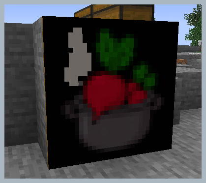

# Paintings

Transforme chaque `Painting` de vos définitions en variante de painting que les joueurs peuvent poser, avec son image dans le resource pack.

Il tourne dans les templates `basic` et `extensive` sous le nom `stewbeet.plugins.custom_paintings`, et lit les images dans `textures_folder`. [Source](https://github.com/Stoupy51/StewBeet/blob/main/python_package/stewbeet/plugins/custom_paintings/__init__.py)

## Déclarer un painting

```python
Painting(
  id="stewbeet_painting",
  painting_data=PaintingData(
    width=2,
    height=2,
  ),
)
```

| Champ | Défaut | Ce qu'il fait |
|---|---|---|
| `width`, `height` | obligatoire | La taille, en blocks |
| `texture` | l'id de l'item | L'image sous `textures_folder`, sans `.png` |
| `title` | le nom de l'item | Le titre dans le tooltip de l'item |
| `author` | l'auteur du projet | L'auteur dans le tooltip de l'item |



## Ce que ce plugin écrit

- `painting_variant/<item>.json` : la taille, le titre, l'auteur et l'image du painting.
- L'image, sous `textures/painting/<item>.png`. Quand la texture propre de l'item est le même fichier, une entrée de l'atlas `paintings` y pointe à la place, si bien que l'image n'est livrée qu'une fois.
- `minecraft:placeable`, le tag de variantes de painting qui liste vos paintings, pour qu'un item painting vanilla puisse aussi les poser.

## Limites

- Sans `texture`, l'image est le fichier nommé `<item>.png`, où qu'il soit sous `textures_folder`. Deux fichiers de ce nom donnent un avertissement et le premier est utilisé. Sans fichier de ce nom, le build échoue.

## Pour continuer

- [Définitions](../1_definitions_setup/fr.md) : tous les champs que prennent un item et un painting.

