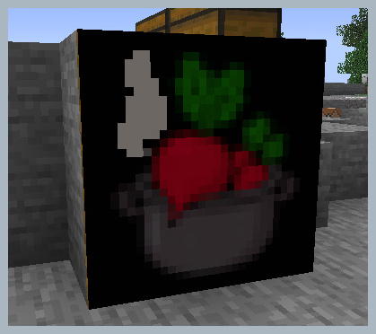

# Paintings

Turns each `Painting` of your definitions into a painting variant players can place, with its image in the resource pack.

It runs in the `basic` and `extensive` templates as `stewbeet.plugins.custom_paintings`, and reads the images from `textures_folder`. [Source](https://github.com/Stoupy51/StewBeet/blob/main/python_package/stewbeet/plugins/custom_paintings/__init__.py)

## Declare a painting

```python
Painting(
  id="stewbeet_painting",
  painting_data=PaintingData(
    width=2,
    height=2,
  ),
)
```

| Field | Default | What it does |
|---|---|---|
| `width`, `height` | required | The size, in blocks |
| `texture` | the item id | The image under `textures_folder`, without `.png` |
| `title` | the item's name | The title on the item's tooltip |
| `author` | the project's author | The author on the item's tooltip |



## What this plugin writes

- `painting_variant/<item>.json`: the size, title, author and image of the painting.
- The image, as `textures/painting/<item>.png`. When the item's own texture is the same file, an entry of the `paintings` atlas points at it instead, so the image ships once.
- `minecraft:placeable`, the painting variant tag that lists your paintings, so a vanilla painting item can place them too.

## Limits

- Without `texture`, the image is the file named `<item>.png` anywhere under `textures_folder`. Two files of that name give a warning and the first is used. No file of that name fails the build.

## Next steps

- [Definitions](../1_definitions_setup/en.md): every field an item and a painting take.

