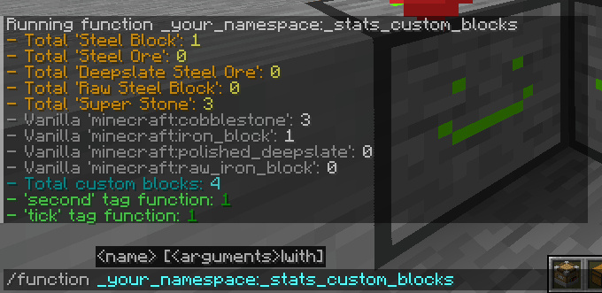

# Custom blocks

Rend chaque `Block` de vos définitions posable. Un block vanilla tient la place dans le monde, et un item display dessine votre model par-dessus.

Il tourne dans les templates `basic` et `extensive` sous le nom `stewbeet.plugins.datapack.custom_blocks`, et lit les blocks que vous avez [déclarés](../items_and_blocks/fr.md) sans configuration. [Source](https://github.com/Stoupy51/StewBeet/blob/main/python_package/stewbeet/plugins/datapack/custom_blocks/__init__.py)

## Tous les fichiers d'un block

Le Life Crystal Block de Stardust Fragment, déclaré une seule fois, donne 14 fichiers :

| Fichiers | Écrits par |
|---|---|
| 4 functions dans `custom_blocks/life_crystal_block/` | ce plugin |
| La recipe de crafting, pour Smithed Crafter | [Recipes](custom_recipes.fr.md) |
| `loot_table/i/life_crystal_block.json` | [Loot tables](datapack.loot_tables.fr.md) |
| La page du manuel, et le block et la recipe dessinés pour elle | [Manuel en jeu](../7_ingame_manual/fr.md) |
| Le model de l'item, sa définition, la texture et son `.mcmeta` | [Item models](resource_pack.item_models.fr.md) |
| Le nom dans `lang/en_us.json` | [Lang file](auto.lang_file.fr.md) |

## Ce que ce plugin écrit

Pour chaque block, dans `function/custom_blocks/<id>/` :

- `place_main` pose le block vanilla et fait apparaître l'item display.
- `place_secondary` nomme le display et lui donne le model du block.
- `destroy` tourne quand le block vanilla a disparu, et retire le display.
- `replace_item` transforme l'item vanilla lâché en le vôtre.

Une fois par pack, dans `function/custom_blocks/` :

- `place` et `on_place` trouvent lequel de vos blocks la bibliothèque Smithed Custom Block vient de poser.
- `destroy` et `_groups/<vanilla block>` envoient un display dont le block vanilla a disparu vers le `destroy` de ce block.
- `get_rotation`, `check_light` et `compute_brightness` orientent le display et accordent sa lumière à celle du monde.

`/function <namespace>:_stats_custom_blocks` compte les blocks posés dans le monde, par block et par block vanilla :

## Options

À définir sur le `vanilla_block=VanillaBlock(...)` du block, ou sur le `Block` lui-même pour les deux dernières.

| Option | Défaut | Ce qu'elle fait |
|---|---|---|
| `id` | obligatoire | Le block vanilla qui tient la place, comme `"minecraft:iron_block"` |
| `block_facing` | `False` | `"player"` oriente le block vanilla comme le fait vanilla, vers le joueur pour un furnace |
| `visual_facing` | `"none"` | `"player"` oriente le model vers le joueur, `"item_frame"` comme l'item frame qui le tient |
| `half` | `None` | `"click"` pose une slab, des stairs ou une trapdoor sur la moitié cliquée par le joueur |
| `interaction` | `None` | Une `Interaction` pour un hôte invisible comme une barrier : coups pour casser, sons, particules, un siège |
| `uvlock` | `False` | Fait tourner les copies du model plutôt que le display, pour que les textures restent sur la grille du monde |
| `margin` | `1.002` | Échelle du model autour du centre du block, pour qu'il soit dessiné devant l'hôte |
| `machine_speed` | `None` | Combien de fois plus vite travaille un hôte furnace, smoker, blast furnace ou brewing stand |
| `contents` | `False` | Une item frame au lieu d'un block vanilla |
| `Block.mining` | `None` | Le niveau d'outil nécessaire pour récupérer l'item |
| `Block.no_silk_touch_drop` | `None` | Ce qu'un minerai lâche sans Silk Touch, avec de l'expérience en option |

## Limites

- Un block sans `vanilla_block` ne peut pas être posé. Le build dit lesquels.
- Le display d'un block cassé disparaît en 2 ticks, et celui d'un minerai dès qu'il lâche son item. Une vérification toutes les 5 secondes rattrape ce qui a échappé.
- Le display est une entité : des milliers de blocks posés coûtent ce que coûtent des milliers d'entités. Le guide [Performance](../10_performance/fr.md) traite de ceux qui tickent.

## Pour continuer

- [Définitions](../1_definitions_setup/fr.md#configuration-de-vanillablock) : chaque option de `VanillaBlock` en détail.
- [Recipes](custom_recipes.fr.md) : comment la recipe d'un block devient une recipe Smithed Crafter.

