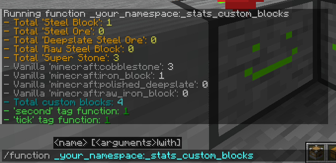

# Custom blocks

Makes every `Block` of your definitions placeable. A vanilla block holds its place in the world, and an item display draws your model over it.

It runs in the `basic` and `extensive` templates as `stewbeet.plugins.datapack.custom_blocks`, and reads the blocks you [declared](../items_and_blocks/en.md) with no configuration. [Source](https://github.com/Stoupy51/StewBeet/blob/main/python_package/stewbeet/plugins/datapack/custom_blocks/__init__.py)

## Every file one block gets

The Life Crystal Block of Stardust Fragment, declared once, ends up as 14 files:

| Files | Written by |
|---|---|
| 4 functions in `custom_blocks/life_crystal_block/` | this plugin |
| The crafting recipe, for Smithed Crafter | [Recipes](custom_recipes.md) |
| `loot_table/i/life_crystal_block.json` | [Loot tables](datapack.loot_tables.md) |
| The manual page, and the block and recipe drawn for it | [In-game manual](../7_ingame_manual/en.md) |
| The item model, its definition, the texture and its `.mcmeta` | [Item models](resource_pack.item_models.md) |
| The name in `lang/en_us.json` | [Lang file](auto.lang_file.md) |

## What this plugin writes

For each block, in `function/custom_blocks/<id>/`:

- `place_main` sets the vanilla block and summons the item display.
- `place_secondary` names the display and gives it the block's model.
- `destroy` runs once the vanilla block is gone, and removes the display.
- `replace_item` turns the dropped vanilla item into yours.

Once per pack, in `function/custom_blocks/`:

- `place` and `on_place` find which of your blocks the Smithed Custom Block library just placed.
- `destroy` and `_groups/<vanilla block>` send a display whose vanilla block is gone to that block's `destroy`.
- `get_rotation`, `check_light` and `compute_brightness` turn the display and match its light to the world.

`/function <namespace>:_stats_custom_blocks` counts the blocks placed in the world, per block and per vanilla block:

## Options

Set on the block's `vanilla_block=VanillaBlock(...)`, or on the `Block` itself for the last two.

| Option | Default | What it does |
|---|---|---|
| `id` | required | The vanilla block that holds the place, such as `"minecraft:iron_block"` |
| `block_facing` | `False` | `"player"` turns the vanilla block the way vanilla turns it, towards the player for a furnace |
| `visual_facing` | `"none"` | `"player"` turns the model towards the player, `"item_frame"` as the frame holding it |
| `half` | `None` | `"click"` places a slab, stairs or trapdoor on the half the player clicked |
| `interaction` | `None` | An `Interaction` for an invisible host such as a barrier: hits to break, sounds, particles, a seat |
| `uvlock` | `False` | Turns copies of the model instead of the display, so textures stay on the world grid |
| `margin` | `1.002` | Scale of the model about the block's centre, so it is drawn in front of the host |
| `machine_speed` | `None` | How many times faster a furnace, smoker, blast furnace or brewing stand host works |
| `contents` | `False` | An item frame instead of a vanilla block |
| `Block.mining` | `None` | The tool level needed to get the item back |
| `Block.no_silk_touch_drop` | `None` | What an ore drops without Silk Touch, with optional experience |

## Limits

- A block with no `vanilla_block` cannot be placed. The build says which ones.
- A broken block's display goes within 2 ticks, and an ore's as soon as it drops its item. A check every 5 seconds catches anything missed.
- The display is an entity: thousands of placed blocks cost what thousands of entities cost. The [Performance](../10_performance/en.md) guide covers the ticking ones.

## Next steps

- [Definitions](../1_definitions_setup/en.md#vanillablock-configuration): every `VanillaBlock` option in detail.
- [Recipes](custom_recipes.md): how the recipe of a block becomes a Smithed Crafter recipe.

