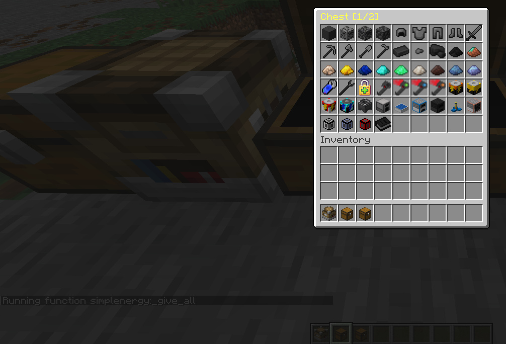

# Loot tables

Écrit une loot table pour chaque item de vos définitions, pour que les commandes, recipes et autres loot tables puissent le donner, et une function qui donne chaque item dans des coffres.

Il tourne dans les templates `basic` et `extensive` sous le nom `stewbeet.plugins.datapack.loot_tables`. Il a besoin de `source_lore` dans la section `stewbeet` de `beet.yml`, que les templates définissent. [Source](https://github.com/Stoupy51/StewBeet/blob/main/python_package/stewbeet/plugins/datapack/loot_tables/__init__.py)

## Donner un item

```mcfunction
loot give @s loot stardust:i/life_crystal
```

Depuis Python, prenez la loot table de l'item :

```python
Item.from_id("life_crystal").loot_table
# stardust:i/life_crystal
```

## Ce que ce plugin écrit

- `loot_table/i/<item>.json` : une par item, avec son item de base et chaque component de sa définition, les components écrits `"!name"` étant retirés.
- `loot_table/i/<item>_x<count>.json` pour chaque nombre autre que 1 que donne l'une des recipes de l'item, comme `i/stardust_ingot_x5`.
- `loot_table/i/<namespace>_manual.json` quand le pack a un manuel : la même que `i/manual`, sous un nom qu'aucun autre pack n'utilise.
- `loot_table/creative_loot_table.json` : un exemplaire de chaque item.
- `function/_give_all` : des coffres de 27 items, nommés "Chest [1/3]" et ainsi de suite, avec le lore source.

Un item avec `skip_gives=True` n'a droit à rien de tout cela.

`/function <namespace>:_give_all` donne les coffres. Ici les deux premiers, posés côte à côte :



## Limites

- Chaque loot table donne l'item et rien d'autre. Un drop avec une chance, une condition d'outil ou Fortune est une loot table que vous écrivez vous-même.

## Pour continuer

- [Définitions](../1_definitions_setup/fr.md) : `skip_gives`, et les components que porte chaque item.

