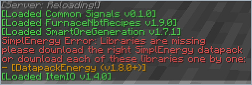

# Library version checks

Fait refuser à votre datapack de se charger quand une bibliothèque ou la version de Minecraft est trop ancienne, et indique aux joueurs dans le chat quelle bibliothèque télécharger.

Il tourne dans les templates `basic` et `extensive` sous le nom `stewbeet.plugins.finalyze.dependencies`, après l'écriture de vos functions, et a besoin de l'`id`, du `name`, de la `version` et de l'`author` du projet. [Source](https://github.com/Stoupy51/StewBeet/blob/main/python_package/stewbeet/plugins/finalyze/dependencies/__init__.py)

## Déclarer une bibliothèque

Les bibliothèques officielles sont trouvées en analysant vos functions : elles n'ont donc besoin d'aucune entrée. Ajoutez les autres sous `meta.stewbeet.load_dependencies`, indexées par leur namespace. Le format complet est dans [`load_dependencies`](../3_beet_config/fr.md#load_dependencies).

```yaml
meta:
  mc_supports: ["26.3", "infinite"]
  stewbeet:
    load_dependencies:
      "energy":
        version: [1, 8, 0]
        name: "DatapackEnergy"
        url: "https://github.com/ICY105/DatapackEnergy"
```

La plus basse release de [`mc_supports`](../3_beet_config/fr.md#mc_supports) est la version de Minecraft que demande le pack.

## Ce que ce plugin écrit

- `load/check_dependencies` compare les scores `load.status` de chaque bibliothèque à la version que le build a téléchargée.
- `load/valid_dependencies` attend un joueur, lit le `DataVersion` du jeu, puis affiche les erreurs ou appelle `confirm_load`.
- `load/secondary` appelle les deux, ou `confirm_load` seul quand il n'y a aucune dépendance.
- `#<namespace>:dependencies` liste le tag de chargement de chaque bibliothèque, pour qu'elles se chargent d'abord. Tous les modules Bookshelf partagent `#bs.load:load`.
- `load/tick_verification` ne lance votre function `tick` qu'une fois le pack chargé.
- `#smart_ore_generation:v1/signals/<name>` lance votre function `calls/smart_ore_generation/<name>`, pour `generate_ores`, `denied_dimensions` et `post_generation`.

Les tags `load:` de Lantern Load sont écrits aussi, et `load.status` est remis à zéro à chaque `/reload`.

Une bibliothèque manquante ou périmée affiche une ligne dorée cliquable avec son nom, la version requise et son `url` :



## Options

| Option | Défaut | Ce qu'elle fait |
|---|---|---|
| `meta.mc_supports` | la version de Minecraft du projet | Releases que le pack supporte, `"infinite"` ignoré |
| `load_dependencies.<ns>.no_lantern_load` | `false` | Laisse la bibliothèque hors du tag de chargement et des vérifications |

## Limites

- Une bibliothèque dont la version n'a pas pu être résolue, par exemple après un téléchargement raté, est écartée des vérifications avec un avertissement.
- Sans joueur en ligne, le pack en attend un avant de se charger.

## Pour continuer

- [Utiliser des bibliothèques de datapack](../5_dependencies/fr.md) : les bibliothèques officielles et la façon dont elles sont téléchargées.

