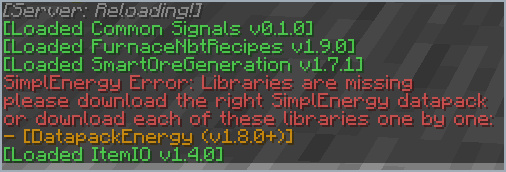

# Library version checks

Makes your datapack refuse to load when a library or the Minecraft version is too old, and tells players in chat which library to download.

It runs in the `basic` and `extensive` templates as `stewbeet.plugins.finalyze.dependencies`, after your functions are written, and needs the project `id`, `name`, `version` and `author`. [Source](https://github.com/Stoupy51/StewBeet/blob/main/python_package/stewbeet/plugins/finalyze/dependencies/__init__.py)

## Declare a library

Official libraries are found by scanning your functions, so they need no entry. Add the others under `meta.stewbeet.load_dependencies`, keyed by their namespace. The full format is in [`load_dependencies`](../3_beet_config/en.md#load_dependencies).

```yaml
meta:
  mc_supports: ["26.3", "infinite"]
  stewbeet:
    load_dependencies:
      "energy":
        version: [1, 8, 0]
        name: "DatapackEnergy"
        url: "https://github.com/ICY105/DatapackEnergy"
```

The lowest release in [`mc_supports`](../3_beet_config/en.md#mc_supports) is the Minecraft version the pack asks for.

## What this plugin writes

- `load/check_dependencies` compares each library's `load.status` scores with the version the build downloaded.
- `load/valid_dependencies` waits for a player, reads the game's `DataVersion`, then prints the errors or calls `confirm_load`.
- `load/secondary` calls both, or `confirm_load` alone when there is no dependency.
- `#<namespace>:dependencies` lists the load tag of every library, so they load first. All Bookshelf modules share `#bs.load:load`.
- `load/tick_verification` runs your `tick` function only once the pack has loaded.
- `#smart_ore_generation:v1/signals/<name>` runs your `calls/smart_ore_generation/<name>` function, for `generate_ores`, `denied_dimensions` and `post_generation`.

The `load:` tags of Lantern Load are written too, and `load.status` is reset at each `/reload`.

A missing or outdated library prints a gold clickable line with its name, the version needed and its `url`:



## Options

| Option | Default | What it does |
|---|---|---|
| `meta.mc_supports` | the project's Minecraft version | Releases the pack supports, `"infinite"` ignored |
| `load_dependencies.<ns>.no_lantern_load` | `false` | Leaves the library out of the load tag and the checks |

## Limits

- A library whose version could not be resolved, for example after a failed download, is left out of the checks with a warning.
- With no player online, the pack waits for one before it loads.

## Next steps

- [Using datapack libraries](../5_dependencies/en.md): the official libraries and how they are downloaded.

