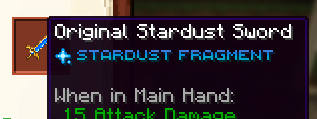

# Project setup

Donne aux deux packs un `pack.mcmeta` et à chaque item une ligne de lore source, à partir de l'identité que vous définissez dans `beet.yml`.

Il tourne dans les templates `basic` et `extensive` sous le nom `stewbeet.plugins.initialize`, lancé par l'entrée `stewbeet` de `require`, et n'a besoin d'aucune configuration. [Source](https://github.com/Stoupy51/StewBeet/blob/main/python_package/stewbeet/plugins/initialize/__init__.py)

## Lore source

La dernière ligne du lore de chaque item custom est le lore source : votre logo et le nom du projet, dessinés avec une font générée dans votre namespace.



```yaml
meta:
  stewbeet:
    source_lore: "auto"
    source_lore_color: "auto"
```

Avec `"auto"`, le logo est votre `pack.png`, cherché dans `src/`, puis `assets/`, puis n'importe quel `*pack.png` à la racine du projet. Sans `pack.png`, seul le nom est dessiné.

`source_lore_color` recolore la font :

- `"auto"` prend la couleur dominante de `pack.png`.
- Une couleur Pillow (`"#55FFFF"`, `"gold"`, `[85, 255, 255]`) l'impose.
- `false` garde l'or fourni dans le pack.

Un `tooltip.png` à côté de `pack.png` remplace l'atlas de caractères, sans jamais être recoloré. Il garde la disposition d'une grille de 16 par 16 glyphes de 8 par 8.

Pour écrire le lore vous-même, remplacez `"auto"` par un text component. `{"text":"ICON"}` représente le glyphe du logo, et la page [Configurer le build](../3_beet_config/fr.md#source_lore-et-source_lore_color) montre un exemple avec une image d'item.

## Ce que ce plugin écrit

- `pack.mcmeta` dans le datapack et le resource pack : `pack_format` depuis `minecraft`, `min_format` et `max_format` là où le format les a, une plage `supported_formats` depuis `mc_supports`, `description` et l'`id` de votre projet.
- La font `{id}:tooltip`, seulement quand une définition d'item porte le lore source.
- Les fichiers renommés dans `textures_folder` (premier niveau seulement), en minuscules, avec les suffixes de côté que cherchent les models générés :

| Dans le nom de fichier | Devient |
|---|---|
| `_off` | supprimé |
| `_down`, `_up` | `_bottom`, `_top` |
| `_north`, `_south` | `_front`, `_back` |
| `_west`, `_east` | `_left`, `_right` |

Chaque renommage affiche un avertissement. Un fichier dont le nouveau nom existe déjà est laissé tel quel.

## Options

| Option | Défaut | Ce qu'elle fait |
|---|---|---|
| `description` | `"{name} [{version}] by {author}"` | La description du `pack.mcmeta`, aussi utilisée quand elle vaut `"auto"` |
| `meta.stewbeet.source_lore` | `"auto"` | La ligne de lore ajoutée à vos items |
| `meta.stewbeet.source_lore_color` | `"auto"` | La couleur de la font du tooltip |
| `meta.stewbeet.manual.name` | `"{name} Manual"` | Le titre du [manuel en jeu](../7_ingame_manual/fr.md) |
| `meta.stewbeet.textures_folder` | aucun | Le dossier dont les noms de textures sont normalisés. Non défini, rien n'est renommé |
| `meta.mc_supports` | aucun | Première et dernière version de Minecraft que supportent les packs, `"infinite"` pour la dernière |

## Limites

- Un `source_lore` qui nomme la font `tooltip` d'un autre namespace avertit, et la font n'est pas générée pour lui.
- Un `meta.mecha.version` plus ancien que `minecraft` avertit, car mecha rejette alors les commandes ajoutées depuis.
- Un `pack.mcmeta` que vous livrez dans `src/` est gardé pour ses autres clés, mais les clés ci-dessus sont écrasées.

