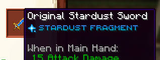

# Project setup

Gives both packs a `pack.mcmeta` and every item a source lore line, from the identity you set in `beet.yml`.

It runs in the `basic` and `extensive` templates as `stewbeet.plugins.initialize`, started by the `stewbeet` entry of `require`, and needs no configuration. [Source](https://github.com/Stoupy51/StewBeet/blob/main/python_package/stewbeet/plugins/initialize/__init__.py)

## Source lore

The last line of each custom item's lore is the source lore: your logo and project name, drawn with a font generated in your namespace.



```yaml
meta:
  stewbeet:
    source_lore: "auto"
    source_lore_color: "auto"
```

With `"auto"`, the logo is your `pack.png`, found in `src/`, then `assets/`, then any `*pack.png` at the project root. Without a `pack.png`, only the name is drawn.

`source_lore_color` recolors the font:

- `"auto"` takes the dominant color of `pack.png`.
- A Pillow color (`"#55FFFF"`, `"gold"`, `[85, 255, 255]`) forces it.
- `false` keeps the packaged gold.

A `tooltip.png` next to `pack.png` replaces the character atlas, never recolored. It keeps the layout of a 16 by 16 grid of 8 by 8 glyphs.

To write the lore yourself, replace `"auto"` with a text component. `{"text":"ICON"}` stands for the logo glyph, and the [Configuring the build](../3_beet_config/en.md#source_lore-and-source_lore_color) page shows an example with an item image.

## What this plugin writes

- `pack.mcmeta` in the datapack and the resource pack: `pack_format` from `minecraft`, `min_format` and `max_format` where the format has them, a `supported_formats` range from `mc_supports`, `description` and your project `id`.
- The `{id}:tooltip` font, only when an item definition carries the source lore.
- Renamed files in `textures_folder` (top level only), in lowercase, with the side suffixes the generated models look for:

| In the file name | Becomes |
|---|---|
| `_off` | removed |
| `_down`, `_up` | `_bottom`, `_top` |
| `_north`, `_south` | `_front`, `_back` |
| `_west`, `_east` | `_left`, `_right` |

Each rename prints a warning. A file whose new name already exists is left alone.

## Options

| Option | Default | What it does |
|---|---|---|
| `description` | `"{name} [{version}] by {author}"` | The `pack.mcmeta` description, also used when set to `"auto"` |
| `meta.stewbeet.source_lore` | `"auto"` | The lore line added to your items |
| `meta.stewbeet.source_lore_color` | `"auto"` | The color of the tooltip font |
| `meta.stewbeet.manual.name` | `"{name} Manual"` | The title of the [in-game manual](../7_ingame_manual/en.md) |
| `meta.stewbeet.textures_folder` | none | The folder whose texture names are normalized. Unset, nothing is renamed |
| `meta.mc_supports` | none | First and last Minecraft version the packs support, `"infinite"` for the latest |

## Limits

- A `source_lore` naming another namespace's `tooltip` font warns, and the font is not generated for it.
- `meta.mecha.version` older than `minecraft` warns, because mecha then rejects commands added since.
- A `pack.mcmeta` you ship in `src/` is kept for its other keys, but the keys above are overwritten.

